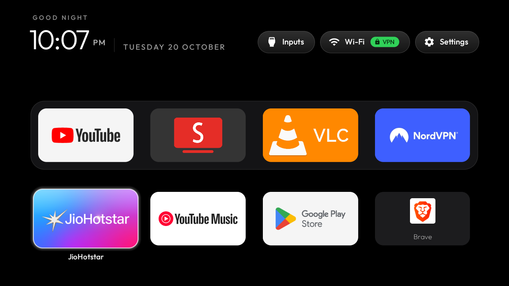
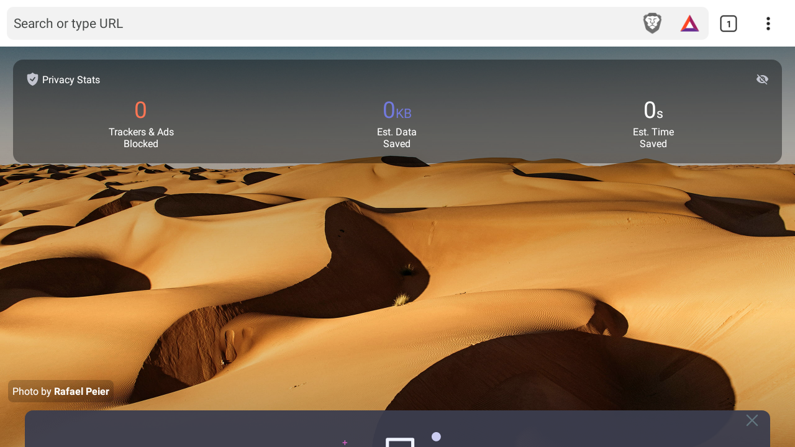

<p align="center">
  <a href="https://cleanyour.tv"></a>
</p>

<p align="center">
  <a href="https://cleanyour.tv">cleanyour.tv</a> ·
  <a href="PROMPT.md">The prompt</a> ·
  <a href="examples/">80 TV lists</a> ·
  <a href="SHOWCASE.md">16 built on it</a> ·
  <a href="https://x.com/gathint/status/2111379569030939102">The tweet</a>
</p>

<p align="center">
  <a href="https://github.com/Gathin23/cleanyourtv/stargazers"></a>
  <a href="https://github.com/Gathin23/cleanyourtv/pulls?q=is%3Amerged"></a>
  <a href="https://github.com/Gathin23/cleanyourtv/network/members"></a>
  <a href="https://github.com/Gathin23/cleanyourtv/graphs/contributors"></a>
  <a href="LICENSE"></a>
  <a href="https://buymeacoffee.com/gathint"></a>
</p>

Strip the bloatware from any Android TV or Google TV over Wi-Fi, and replace the ad-filled home
screen with a clean launcher that looks like an Apple TV. **No root, no cable, nothing uninstalled,
and a one-line restore if you change your mind.**

<h3 align="center">80 TV models &nbsp;·&nbsp; 28 brands &nbsp;·&nbsp; 15 languages &nbsp;·&nbsp; 300 KB launcher</h3>

<p align="center">
  <sub><b>FEATURED IN</b></sub><br><br>
  <a href="https://techcrunch.com/2026/10/19/people-are-using-ai-to-make-their-smart-tvs-dumb-again/"></a>&nbsp;&nbsp;
  <a href="https://mashable.com/tech/smart-tv-ads-claude-code-ai-cleanup"></a>&nbsp;&nbsp;
  <a href="https://itsfoss.com/news/debloat-smart-tv/"></a>&nbsp;&nbsp;
  <a href="https://techaeris.com/2026/10/18/android-tv-debloat-tvos-style-makeover/"></a>&nbsp;&nbsp;
  <a href="https://www.techtimes.co.uk/ai-smart-tv-bloatware-performance-fix-1809233"></a>&nbsp;&nbsp;
  <a href="https://tech.yahoo.com/ai/meta-ai/articles/developers-using-ai-strip-ads-185856468.html"></a>&nbsp;&nbsp;
  <a href="https://techpp.com/2026/10/18/speed-up-android-tv-claude-code/"></a>&nbsp;&nbsp;
  <a href="https://www.frandroid.com/android/google-tv/3290159_google-tv-lent-et-envahi-par-les-pubs-le-projet-tv-vibehack-corrige-tout-ca-grace-a-lia-jai-tente-lexperience"></a>&nbsp;&nbsp;
  <a href="https://www.xboxygen.com/News/371393-sa-tv-xiaomi-affichait-des-pubs-partout-il-donne-son-modele-a-claude-code-qui-refait-toute-linterface"></a>&nbsp;&nbsp;
  <a href="https://itavisen.no/2026/10/19/vibekodet-bort-reklame-smart-tv/"></a>&nbsp;&nbsp;
  <a href="https://pplware.sapo.pt/inteligencia-artificial/nem-as-smart-tv-escaparam-a-febre-do-vibe-coding-a-televisao-a-medida-de-cada-utilizador/"></a>&nbsp;&nbsp;
  <a href="https://insmart.cz/android-tv-bez-reklam-ai-claude-code/"></a>&nbsp;&nbsp;
  <a href="https://inet.detik.com/consumer/d-8713172/kesal-tv-xiaomi-banyak-iklan-pria-ini-sulap-jadi-apple-tv-pakai-ai"></a>&nbsp;&nbsp;
  <a href="https://www.iphonemod.net/clean-your-tv-android-tv-debloat-launcher.html"></a>
</p>


> Vibe coded my parents' TV this afternoon! It was showing a sponsored ad before you could even get
> to Netflix. Gave Claude Code the model number, it found the TV on wifi, removed 25 Xiaomi packages
> and wrote a new launcher. Looks like an Apple TV now lol.
>
> [@gathint, 17 October 2026](https://x.com/gathint/status/2111379569030939102). The replies are where
> most of the TV lists here came from. The repo was called tv-vibehack until the 19th; old links work.

## End-to-End Case Study: SPPL `PATH_7XPRO` (`LEDTV32HD` — Android TV 9, 1 GB RAM)

Complete, reproducible end-to-end documentation and visual proof for debloating, cleaning, optimizing, and replacing the stock ad-heavy launcher on the **SPPL `PATH_7XPRO`** (`Kodak / Thomson 7XPRO Series`, `LEDTV32HD`, Android TV 9, Amlogic `AMLT950X`, 1 GB RAM).

- **Complete Chronological Engineering Worklog:** [`DEBLOAT_WORKLOG.md`](DEBLOAT_WORKLOG.md)
- **Full Engineering Report & Guide:** [`examples/sppl-path-7xpro/README.md`](examples/sppl-path-7xpro/README.md)
- **Debloat Package List (42 System Packages):** [`examples/sppl-path-7xpro/debloat.txt`](examples/sppl-path-7xpro/debloat.txt)
- **Initial Device Backup & One-Click Restore:** [`backup-path-7xpro/README.md`](backup-path-7xpro/README.md) · [`backup-path-7xpro/restore-all.ps1`](backup-path-7xpro/restore-all.ps1)

### 1. Visual Proof: Before vs. After (End-to-End)

| Before — Stock Android TV Home (Sponsored Rows & Clutter) | After — CleanYourTV Custom Dock & Ambient Glow (`com.gathin.tvhome`) |
|---|---|
|  |  |

| After — Single-Screen App Grid (Only 7 Essential Apps) | After — Hardware Inputs Menu (`HDMI 1–3`, `AV 1–2`, `Live TV`) |
|---|---|
|  |  |

| 4-Way App Move Mode (`Hold OK` / `Menu` → `MOVE APP · ◀ ▲ ▼ ▶ · OK DONE`) | Move Completed & Persisted (`Press OK` / `Back`) |
|---|---|
|  |  |

| Home Screen with Sideloaded Brave Browser (`8` Apps in 2×4 Grid) | Brave Browser (`v1.80.126`) Running in Full 16:9 `1280×720` Landscape |
|---|---|
|  |  |

| Batch 1 (Telemetry & Factory Tests Disabled) | Batch 2 (Sponsored Rows & Recommendations Disabled) | Batch 3 (Unused System Providers & Duplicate Apps Disabled) |
|---|---|---|
|  |  |  |

### 2. Measured Performance, RAM & Storage Benchmarks

| Metric | Before Optimization | After Optimization | Measured Improvement |
|---|---|---|---|
| **Available RAM (of `1,014 MB`)** | **`279 MB`** (`MemFree: 36 MB`) | **`563 MB`** (`MemFree: 311 MB`) | **+284 MB RAM freed (`2.02×` available RAM, `55.5%` of total RAM free)** |
| **Free Storage (`/data` of `4.2 GB`)** | `3.7 GB` used / **`516 MB` free (`89%` full)** | `1.9 GB` used / **`2.2 GB` free (`47%` used)** | **+1.7 GB freed (`4.3×` more free space)** |
| **System Bloatware Packages** | `0` disabled (`102` packages active) | **`42` system bloat & telemetry packages disabled** | Stripped `/data` updates & wiped package caches |
| **Third-Party Apps** | `14` third-party apps + `458 MB` leftover APKs | **`11` redundant apps uninstalled + Brave Browser (`v1.80.126`) added** | Only **8 essential apps** remain (clean 2×4 single-screen grid) |
| **SmartTube (`org.smarttube.stable`)** | `v32.10` (`universal` APK) | **`v32.56 Stable` (`armeabi-v7a` native)** | Upgraded to latest architecture-matched build |
| **Brave Browser (`com.brave.browser`)** | Not installed | **`v1.80.126` (`BraveMonoarm.apk`, Chromium 138)** | Final official Android 9 (`SDK 28`, `armeabi-v7a`) release; runs in 16:9 landscape |
| **App Runtime Compilation (`dex2oat`)** | Interpreted / partial profile | **`cmd package compile -m speed -f`** | **100% AOT native ARM machine code** for instant cold starts |
| **UI Animation Scales** | `1.0x` (stock) | **`0.5x`** (`window`, `transition`, `animator`) | **2× snappier UI transitions** |
| **App Reordering in Launcher** | Static XML order only | **4-Way D-Pad Move Mode (`◀ ▲ ▼ ▶`)** | Hold `OK` on any tile → move `Left/Right/Up/Down` → `OK` to save |

### 3. Target Hardware & Firmware Profile

| Property | Value |
|---|---|
| **Manufacturer / Brand** | `SPPL` (Super Plastronics Pvt Ltd — Kodak / Thomson 7XPRO Series, India) |
| **Model / Device** | `PATH_7XPRO` / `LEDTV32HD` |
| **SoC / Board** | Amlogic `AMLT950X` (`droidlogic`, 4× ARM Cortex-A53 @ `armeabi-v7a`) |
| **Android Version** | Android TV 9 (Pie, SDK 28), Build `PI.20210601 release-keys` |
| **Memory & Storage** | `1,014 MB` RAM (`1.5 GB` ZRAM swap) · `4.2 GB` `/data` partition |
| **Stock Home Launcher** | `com.google.android.tvlauncher/.MainActivity` |
| **New Home Launcher** | `com.gathin.tvhome/.MainActivity` (~300 KB native Java launcher) |
| **Hardware Inputs Handler** | `com.android.tv` + `com.droidlogic.tvinput` (`HDMI1`, `HDMI2`, `HDMI3`, `AV1`, `AV2`, `Live TV`) |

> **Firmware Quirk on `SPPL PATH_7XPRO`:** Turning on **USB debugging** in *Developer options* for the first time does not immediately open TCP port `5555` (`adbd`). Toggling **USB debugging OFF and back ON** (or rebooting the TV with USB debugging enabled) starts `adbd` on `:5555` over Wi-Fi.

### 4. In-Depth Phase-by-Phase Breakdown of Everything Done

#### Phase 1 — Local Wi-Fi Discovery (`192.168.29.239:5555`) & Full Baseline Backup ([`backup-path-7xpro/`](backup-path-7xpro/))
1. Scanned the local `192.168.29.0/24` Wi-Fi subnet for open TCP port `5555` and discovered the TV at `192.168.29.239:5555`.
2. Paired via `tools/tv.py` (pure-Python ADB implementation) and saved a complete, byte-accurate baseline snapshot to [`backup-path-7xpro/`](backup-path-7xpro/) before modifying a single setting:
   - **Package Inventories:** [`packages-all.txt`](backup-path-7xpro/packages-all.txt) (`110` total packages), [`packages-enabled.txt`](backup-path-7xpro/packages-enabled.txt) (`109` enabled), [`packages-disabled.txt`](backup-path-7xpro/packages-disabled.txt) (`1` pre-disabled: `com.amazon.amazonvideo.livingroom`), [`packages-system.txt`](backup-path-7xpro/packages-system.txt) (`95` system packages), [`packages-thirdparty.txt`](backup-path-7xpro/packages-thirdparty.txt) (`15` third-party packages), [`packages-paths.txt`](backup-path-7xpro/packages-paths.txt).
   - **System Properties & Settings:** [`getprop.txt`](backup-path-7xpro/getprop.txt), [`settings-global.txt`](backup-path-7xpro/settings-global.txt), [`settings-secure.txt`](backup-path-7xpro/settings-secure.txt), [`settings-system.txt`](backup-path-7xpro/settings-system.txt).
   - **One-Click Rollback Script:** [`backup-path-7xpro/restore-all.ps1`](backup-path-7xpro/restore-all.ps1) to re-enable every disabled package, restore animations (`1.0`), and restore the stock launcher at any time.

#### Phase 2 — Custom Apple TV-Style Launcher (`com.gathin.tvhome`) & Hardware Inputs Integration
1. Configured [`launcher/app/src/main/res/values/config.xml`](launcher/app/src/main/res/values/config.xml):
   - **Pinned Dock (`dock_apps`):** `org.smarttube.stable` (SmartTube), `com.google.android.youtube.tvmusic` (YouTube Music), `com.google.android.youtube.tv` (YouTube), `org.videolan.vlc` (VLC), with `fill_dock = true`.
   - **Hidden System Entries (`hidden_apps`):** `com.android.tv`, `com.google.android.tv`, `com.droidlogic.tv.settings` (kept off the app grid because they are launched directly from the top-bar **Inputs** and **Settings** pills).
   - **Hardware Input Switching (`live_tv_package`):** Bound to `com.android.tv` + Amlogic `com.droidlogic.tvinput`, exposing **`HDMI 1`**, **`HDMI 2`**, **`HDMI 3`**, **`AV 1`**, **`AV 2`**, and **`Live TV`** in the top-bar **Inputs** dropdown with live cable connection state detection.
   - **VPN Pill Integration (`vpn_app`):** Bound to `com.nordvpn.android` so the top bar shows a live green **`VPN`** badge when NordVPN is connected or **`VPN off`** when disconnected, opening NordVPN on click (or Wi-Fi settings on long-press).
2. Built the ~300 KB APK via [`launcher/build-and-install.ps1`](launcher/build-and-install.ps1), installed it onto the TV, set `com.gathin.tvhome/.MainActivity` as default `HOME`, and configured `com.gathin.tvhome/.ClockDream` as the default screensaver (`5 min` timeout).

#### Phase 3 — 4-Way D-Pad App Reordering (`Move Mode`) Engineered & Verified on TV
Modified [`launcher/app/src/main/java/com/gathin/tvhome/AppAdapter.java`](launcher/app/src/main/java/com/gathin/tvhome/AppAdapter.java) and [`launcher/app/src/main/java/com/gathin/tvhome/MainActivity.java`](launcher/app/src/main/java/com/gathin/tvhome/MainActivity.java) so apps can be reordered in all 4 directions (`Left`, `Right`, `Up`, `Down`) across the Dock and Grid using only the TV remote:
- **How to Trigger:** Hold **`OK`** (`KEYCODE_DPAD_CENTER` / `KEYCODE_ENTER` ≥ 450 ms) or press **`Menu`** (`KEYCODE_MENU`) on any app tile.
- **Visual Cues:** Top greeting bar switches to gold `MOVE APP · ◀ ▲ ▼ ▶ · OK DONE`, the focused app title displays `◀ ▲ ▼ ▶ <App Name>`, and the focused tile scales up (`1.18×`).
- **4-Way D-Pad Swapping (`swapItems`):**
  - Enabled `setHasStableIds(true)` on `AppAdapter` (keyed by component name hash) and used `notifyDataSetChanged()` with pre-scrolling (`grid.scrollToPosition(to)`) so `RecyclerView` re-lays out cross-row (`Up`/`Down`) and same-row (`Left`/`Right`) swaps across the Dock divider without losing D-pad focus.
  - Temporarily disabled focusability on the top-bar pills (`Inputs`, `VPN`, `Settings`) while `moving == true` so pressing **D-Pad Up** on Row 1 never escapes the app grid.
- **Persistent Storage:** Saved immediately to `SharedPreferences` (`settings.xml` → `app_order`) as a comma-separated component list so custom order survives app reloads and TV reboots.
- **Sideloaded Non-Leanback App Support (`CATEGORY_LAUNCHER`):** Updated `AppAdapter.reload()` to automatically include non-system (`FLAG_SYSTEM == 0`) apps that only declare `android.intent.category.LAUNCHER` (such as **Brave Browser**) alongside standard `CATEGORY_LEANBACK_LAUNCHER` Android TV apps.

#### Phase 4 — 42 System Bloatware, Telemetry & Background Packages Disabled ([`examples/sppl-path-7xpro/debloat.txt`](examples/sppl-path-7xpro/debloat.txt))
All 42 packages below were disabled via `pm disable-user --user 0`, force-stopped (`am force-stop`), stripped of `/data/app` Play Store updates (`pm uninstall --user 0` on updated system apps to reclaim `/data` storage blocks), and wiped of `/data/data` caches (`pm clear`):

| Batch | Category | Packages Disabled (`42` Total) |
|---|---|---|
| **Batch 1 (10 pkgs)** | Telemetry, Analytics, Partner Auto-Installs & Factory Test Suites | `com.google.android.feedback`, `com.google.android.tv.bugreportsender`, `com.google.android.partnersetup`, `android.autoinstalls.config.amlogic.device`, `com.google.android.onetimeinitializer`, `com.android.onetimeinitializer`, `com.ctv.factorytest`, `com.tvfactory`, `com.cultraview.agingmodel`, `com.sppl.emanual` |
| **Batch 2 (7 pkgs)** | Stock Launchers, Sponsored Ad Rows & Google Bloat | `com.google.android.tvlauncher`, `com.google.android.tvrecommendations`, `com.google.android.leanbacklauncher.recommendations`, `com.google.android.leanbacklauncher`, `com.google.android.videos` (Play Movies & TV), `com.google.android.play.games` (Play Games), `com.google.android.apps.nbu.smartconnect.tv` (SmartConnectTV) |
| **Batch 3 (13 pkgs)** | Unused Phone/Print/Camera Providers, TalkBack & Vendor Media Duplicates | `com.android.printspooler`, `com.android.camera2`, `com.android.smspush`, `com.android.providers.calendar`, `com.google.android.syncadapters.calendar`, `com.android.providers.contacts`, `com.google.android.syncadapters.contacts`, `com.android.providers.userdictionary`, `com.android.dreams.basic`, `com.google.android.marvin.talkback` (`54 MB` reclaimed), `com.ctv.photoplayer`, `com.ctv.music`, `com.yunfang.files` |
| **Batch 4 (12 pkgs)** | Setup Wizards, Ambient Backdrop, Cloud Backup & Duplicate TV Apps | `com.google.android.backdrop` (Ambient Mode), `com.google.android.tungsten.setupwraith`, `com.google.android.tvsetup.partnercustomizer`, `com.droidlogic.videoplayer`, `com.google.android.tv` (duplicate Live Channels), `com.android.wallpaperbackup`, `com.android.wallpapercropper`, `com.android.htmlviewer`, `com.android.backupconfirm`, `com.android.sharedstoragebackup`, `com.google.android.backuptransport`, `com.amazon.amazonvideo.livingroom` |

#### Phase 5 — 11 Redundant Third-Party Apps Uninstalled, 458 MB of Leftover APKs Cleaned & SmartTube Upgraded
1. **Uninstalled 11 redundant third-party apps (`pm uninstall`):**
   - **Utility Apps Removed:** `com.esaba.downloader` (`Downloader`), `com.alphainventor.filemanager` (`File Manager +`), `com.yablio.sendfilestotv` (`Send Files to TV`), `com.teamsmart.videomanager.tv` (legacy SmartTube Next), `com.mxtech.videoplayer.ad` (`MX Player`).
   - **Streaming Apps Removed (per user selection, keeping only JioHotstar):** `com.discoveryplus.tv.android` (`discovery+`), `com.mubi` (`MUBI`), `com.htlabs.ottplay` (`OTTplay`), `com.sonyliv` (`SonyLIV`), `com.tubitv` (`Tubi`), `com.graymatrix.did` (`ZEE5`).
2. **Cleaned `458 MB` of Leftover Installer Packages in `/sdcard/Download` & `/sdcard/Downloader`:**
   - Moved all user `.srt` subtitle files safely to `/sdcard/Subtitles/` and deleted all leftover `.apk`, `.apkm`, `.zip` (`mx_aio.zip`), and orphaned `/sdcard/Android/data/` directories.
3. **Upgraded SmartTube (`org.smarttube.stable`) to `v32.56 Stable` (`armeabi-v7a`):**
   - Downloaded and installed `SmartTube_stable_32.56_armeabi-v7a.apk` from [`yuliskov/SmartTube`](https://github.com/yuliskov/SmartTube/releases/tag/32.56s), replacing the bloated `universal` APK (`v32.10`) with the native 32-bit ARMv7 build.
4. **Installed Brave Browser (`com.brave.browser` `v1.80.126` — `BraveMonoarm.apk`):**
   - Verified `AndroidManifest.xml` across [`brave/brave-browser`](https://github.com/brave/brave-browser/releases/tag/v1.80.126) releases: Brave `v1.81+` (Chromium 139+) dropped Android 9 (`minSdkVersion=29`), making **`v1.80.126` (Chromium 138.0.7204.184, `minSdkVersion=26`, `armeabi-v7a`)** the final official release supporting Android TV 9 (`SDK 28`).
   - Installed `BraveMonoarm.apk`, completed first-run onboarding with crash reporting & P3A telemetry unchecked, restricted background wakeups (`cmd appops set com.brave.browser RUN_IN_BACKGROUND ignore`), and locked `accelerometer_rotation=0` + `user_rotation=0` so Brave runs in full `1280×720` 16:9 landscape.
5. **Final 8 Essential Apps Remaining on the TV (Clean 2×4 Single-Screen Layout):**
   - **Dock (Row 1):** `YouTube`, `SmartTube (v32.56)`, `VLC`, `NordVPN` (also bound to top-bar `VPN` badge)
   - **Grid (Row 2):** `JioHotstar`, `YouTube Music`, `Google Play Store`, `Brave Browser (v1.80.126)`

#### Phase 6 — Deep CPU (`dex2oat -m speed`), Background RAM (`RUN_IN_BACKGROUND`) & System Tuning
1. **100% Native ARM AOT Compilation (`cmd package compile -m speed -f`):**
   - Compiled `com.gathin.tvhome`, `org.smarttube.stable`, `in.startv.hotstar`, `com.google.android.youtube.tv`, `com.google.android.youtube.tvmusic`, `org.videolan.vlc`, `com.nordvpn.android`, `com.android.tv.settings`, and `com.android.tv` ahead-of-time to eliminate JIT overhead on the quad-core Cortex-A53 CPU.
2. **Background RAM & Wakeup Restriction (`cmd appops set <pkg> RUN_IN_BACKGROUND ignore`):**
   - Applied to `com.android.vending` (Play Store — saved **~109 MB RAM**), `in.startv.hotstar`, `com.google.android.youtube.tv`, `com.google.android.youtube.tvmusic`, and `org.videolan.vlc`.
3. **System Settings & Animation Tuning:**
   - Set `window_animation_scale`, `transition_animation_scale`, and `animator_duration_scale` to `0.5`.
   - Disabled background Wi-Fi/BLE scanning (`wifi_scan_always_enabled=0`, `ble_scan_always_enabled=0`), Play Protect install verification (`package_verifier_enable=0`, `verifier_verify_adb_installs=0`), and system error/activity telemetry (`activity_starts_logging_enabled=0`, `send_action_app_error=0`, `dropbox_max_files=10`).
   - Trimmed all filesystem caches (`pm trim-caches 16G`).

---

## How it works

Android TVs have the same debug bridge as Android phones. Switch on USB debugging in the TV's
developer options, allow your computer once, and the rest is standard Android tooling:

1. **Back up** the list of installed packages and settings.
2. **Disable** the manufacturer's telemetry, ad services, content rows and preloaded junk with
   `pm disable-user`. Nothing is uninstalled, so a restore script can undo every step.
3. **Install** a small native launcher and make it the default home screen.

The bloat differs by brand, so the prompt has your coding assistant discover it on your TV and ask
before touching anything you might use.

## Quick start

You need a computer on the same Wi-Fi as the TV and a coding assistant with shell access
(Claude Code or similar).

| | |
|---|---|
| **1. On the TV** | Settings → Device Preferences → About → press OK on **Build** seven times → back → Developer options → **USB debugging** on. If you see a Network or ADB debugging toggle, turn that on too. Keep the TV on. |
| **2. On your computer** | Paste [`PROMPT.md`](PROMPT.md) into your assistant and fill in your TV model. |
| **3. Follow along** | Accept "Allow USB debugging?" on the TV, then answer the checklist: which apps you use, which four go in the dock, whether to keep the voice assistant, Chromecast and updates. |

The assistant backs up, debloats, builds and installs the launcher, and checks each step with
screenshots pulled from the TV. With this repo as context it takes about fifteen minutes.

## What you get

- **A pitch-black home** with a dock of your four favourite apps in a rounded band, where Apple TV puts it.
- **A top shelf** naming the focused app in large type, with an ambient glow in a colour taken from its artwork.
- **The rest of your apps in a grid** that slides up when you press Down.
- **One floating glass highlight** that springs from tile to tile. The focused tile lifts and shows its name.
- **Three frosted buttons**: Inputs (HDMI ports, AV, Live TV), Wi-Fi or Ethernet with the network name, Settings.
- **A greeting, a thin clock and the date** in [Outfit](https://fonts.google.com/specimen/Outfit), and a matching Clock screensaver.
- **Themes** that change colours, wallpaper, dock and columns without a rebuild, and **module cards** that let other apps plug a tile in, only with your say-so.

And a TV that stops working against you: no sponsored rows, no "Discover" nags, no analytics
phoning home, no apps you never asked for.

| | |
|---|---|
|  |  |
| *Top shelf and ambient glow* | *Inputs: HDMI with connection state, AV, Live TV* |
|  |  |
| *The grid, one glass highlight, the tile's name* | *Clock screensaver, drifts so nothing burns in* |
|  |  |
| *Aurora theme, pushed with `tools/theme.sh`* | *Six columns and a six-app dock, same launcher* |

## Supported TVs

Anything running **Android TV** or **Google TV**. Samsung (Tizen) and LG (webOS) run different
systems; see [SHOWCASE.md](SHOWCASE.md) for a webOS port. **Fire TV** takes the debloat half only,
since Fire OS will not hand Home to a third-party launcher. A few China-market TCL sets refuse to
install any launcher at all; their lists say so in the header.

Tested lists from contributors, one folder per model in [`examples/`](examples/):

**TCL** 16 · **Xiaomi** 15 · **Sony** 13 · **Hisense** 4 · **Philips** 4 · **BenQ** 2 · **CHiQ** 2 ·
**Hitachi** 2 · **Panasonic** 2 · **Skyworth** 2 · AiPro2K · Amazon Fire TV Stick · Chromecast with Google TV ·
Haier · Insignia Fire TV · Kalley · NVIDIA Shield · OnePlus · onn · PRISM+ · RCA · Redmi · SANYO · Thomson ·
Toshiba Fire TV · Vu · Stellamore and XGIMI projectors

<details>
<summary><strong>The full list</strong></summary>

| TV | OS |
|---|---|
| AiPro2K (Expressluck, dongnae; Changhong AI PONT family) | Android TV 14 |
| Amazon Fire TV Stick 4K, 1st gen 2018 (AFTMM, mantis) | Fire OS 6.7.1.1 / Android 7.1 |
| BenQ E55-735 (Changhong AI PONT, DVB96BQ) | Google TV 14 |
| BenQ E55-750 (Changhong AI PONT, DVB96BQ) | Google TV (Android 11) |
| CHiQ AI PONT (Changhong GTVU65, dangni, MediaTek mt5867) | Google TV 14 |
| CHiQ AI PONT (DVB93CQ) | Android TV 11 |
| Chromecast with Google TV 4K (sabrina) | Google TV 14 |
| Haier H32S80EFX (MatrixTV CE, HRT56EU, deto, MediaTek), Thailand | Google TV 14 |
| Hisense HiSmartTV A4 (xiaoyushan, MStar m7322), Android 11 firmware RTT2.221108.001 | Android TV 11 |
| Hisense HiSmartTV A4 (xiaoyushan, MStar m7322), India | Android TV 9 |
| Hisense SmartTV 4K FFM (huangshan, MediaTek) | Android TV 10 |
| Hisense U75 (hengshan, MediaTek), Latin America | Google TV 12 |
| Hitachi 65QLEDSM20 (MTC, bangbae, MediaTek m7322), Australia | Android TV 11 |
| Hitachi CDH-LE32SMART21 (TCL-built C06, C06_2K_GB, MediaTek MT9221, 1 GB), Argentina | Android TV 11 |
| Insignia 55" F30 4K Fire TV (NS-55F301NA25, AFTDCT31, duckie) | Fire OS 7 / Android 9 |
| Kalley R10G (device R10G, product ACER_FFM, MOKA, Realtek RTD2875P), Latin America | Google TV 14 |
| NVIDIA SHIELD TV Pro 2019 (P2897, mdarcy) | Android TV 11 |
| OnePlus TV (D00, Dubai) | Google TV 14 |
| onn 4K Streaming Box (2023, Walmart; YOC, Amlogic), US | Google TV 14 |
| Panasonic 4KTV-JUP (Jupiter_PA, MediaTek) | Android TV 11 |
| Panasonic TH-40HS550K (Skyworth-built, GS655 shibuya, MediaTek) | Android TV 11 |
| Philips 50PUS8517/12 (TP Vision, PH1M_EA_9970A, MediaTek MT5895), Europe | Android TV 11 |
| Philips 55PUS7503/12 (TP Vision TPM171E, PH7M_EU_5596, MediaTek MT5891), Europe | Android TV 8.0 |
| Philips R8G Google TV (MOKA, whitefield, Realtek RTD2851F), US | Google TV 14 |
| Philips Smart 4K TV (Skyworth, eleonas, MediaTek), India | Google TV 14 |
| PRISM+ Q65 Ultra 2026 QLED 4K AI Google TV (R10G, PRISMPLUS_FFM, MOKA, Realtek RTD2875 SoC, RTD6748 platform) | Google TV 14 |
| RCA AI PONT SA (Changhong, redwood, ISDB92RC; also sold as realme 40-inch) | Android 14 |
| Redmi TV (MiTV-ANTL0, starwars) | Android 5.1.1 (not Android TV) |
| SANYO ATV R2 (SCBC, Realtek RTD285O) | Android TV 9 |
| Skyworth SWTV-21AE (sunnyvale, MediaTek) | Android TV 14 |
| Skyworth SWTV-24NA-4K NF (eleonas, MediaTek mt5896), US | Google TV 14 |
| Sony BRAVIA 4K AE2 (BRAVIA_AE2, MediaTek MT5897), North America | Google TV 14 |
| Sony BRAVIA 4K GB (BRAVIA_ATV2_EU, BRAVIA_ATV2) | Android TV 9 |
| Sony BRAVIA 4K GB (BRAVIA_ATV2_UC, MediaTek mt5891) | Android TV 9 |
| Sony BRAVIA 4K UR2 (BRAVIA_UR2_4K, MediaTek) | Android TV 10 |
| Sony BRAVIA 4K VH2 (KD-55X80J, BRAVIA_VH2, MediaTek), EU | Google TV 12 |
| Sony BRAVIA 9 II (K-65XR90M2, BRAVIA_AE3, MediaTek MT5838) | Google TV 14 |
| Sony BRAVIA BF1 (BRAVIA 2 II class, BRAVIA_BF1_4K_A, MediaTek) | Google TV 12 |
| Sony BRAVIA KD-55X85J (2021, BRAVIA_VH2, MediaTek MT5895), South America | Google TV 12 |
| Sony BRAVIA KD-65X80J (2021, BRAVIA_VH2, MediaTek), India | Google TV 10 |
| Sony BRAVIA KD-65X9300D (2016, SVP-DTV15, MediaTek), Asia-Pacific | Android TV 8.0 |
| Sony BRAVIA VU31 4K (BRAVIA_VU31_4K, Realtek), India | Google TV 14 |
| Sony BRAVIA XBR-65X900E (2017, BRAVIA_ATV2) | Android TV 9 |
| Sony BRAVIA XBR-65X900F (2018, BRAVIA_ATV3_4K, MediaTek MT5891), US/Canada | Android TV 9 |
| SPPL PATH_7XPRO (Kodak / Thomson 7XPRO, LEDTV32HD, Amlogic AMLT950X, 1 GB), India | Android TV 9 |
| Stellamore T950S projector (Droidlogic be30a3, Amlogic txhd2) | Android 13 |
| TCL 40S5400A (C06, C06_2K_GB, MediaTek MT9221, 1 GB) | Android TV 11 |
| TCL 43C645 (Smart TV Pro, Realtek RTD2851 / R51MT05, V8-R51MT05-LF1V652) | Google TV launcher on Android TV 11 |
| TCL 50EP680 (Europe, BeyondTV, Realtek rtd285o) | Android TV 11 |
| TCL 55" 4K Google TV, 2023 (G10, G10_4K_US_NF); also TCL 55P6K, Spain (G10_4K_GB_NF_32BIT) | Google TV 12 |
| TCL 55Q10G Pro (China, tcl_mt5879_cn, MediaTek MT9952) | Android TV 11 |
| TCL 55S470G (G10, G10_4K_US_NF, Realtek), US | Google TV 12 |
| TCL 65C725 (Smart TV Pro, BeyondTV4) | Android TV 11 |
| TCL 65C735 (Smart TV Pro, G05, MediaTek), France | Google TV 11 |
| TCL ak30a5 (China, Amlogic) | Android TV 9 |
| TCL BeyondTV (India) | Android TV 9 |
| TCL BeyondTV, EU/Nordic (Realtek RTD2851, V8-R851T02-LF1V606) | Android TV 9 |
| TCL BeyondTV2 (Latin America / Brazil, Realtek RTD2851) | Android TV 9 |
| TCL C755 QD-Mini LED, 2024, Australia (G08, MediaTek tcl9618) | Google TV 14 |
| TCL QM6K Pro, 2025 (G08, MediaTek tcl9618) | Google TV 14 |
| TCL Smart TV Pro (G05, G05_4K_US, MediaTek MT5889) | Google TV 11 |
| TCL UnionTV, Latin America (TCL-built like Thomson 32HE5800, Realtek RT2841) | Android TV 9 |
| Thomson 32HE5800 (TCL-built UnionTV, Realtek RT2841), Spain | Android TV 9 |
| Toshiba Fire TV (AFTHA004, hazel) | Fire OS 7 / Android 9 |
| Vu 4K (HVCL, lushan, MediaTek), India | Google TV 12 |
| XGIMI Horizon S Pro projector (XK03H, xgimigalileo, MediaTek) | Android TV 11 |
| Xiaomi Mi Box S (MIBOX4, oneday), streaming box | Android TV 9 |
| Xiaomi Mi Box S 2nd gen (MiTV-AFKR0, jaws), streaming box | Google TV 11 |
| Xiaomi Mi TV (MiTV-MOOQ0, croods) | Android TV 10 |
| Xiaomi Mi TV 4A (MiTV-MOOQ1) | Android TV 10 |
| Xiaomi MiTV-AESP0 stick (aquaman, 1 GB) | Android TV 9 |
| Xiaomi MiTV-ASTP1 (maverick), China firmware 2.40.641.0514.cn, 1 GB RAM, 720p | Android TV 9 (CN build) |
| Xiaomi MiTV-AXFR1 (rango, Amlogic, 1 GB), India | Android TV 11 |
| Xiaomi MiTV-AXSO0 (dangal; Mi TV 4C Pro 2019 / 4A Pro) | Android TV 9 |
| Xiaomi MiTV-AXSO2 (dangalUHD, India, 2 GB) | Android TV 9 |
| Xiaomi MiTV-MOOR2 (venom, MediaTek) | Google TV 11 |
| Xiaomi MiTV-MOSR4 (irobot, MediaTek) | Google TV 11 |
| Xiaomi MiTV-MSSP3 (machuca, MediaTek) | Android TV 11 |
| Xiaomi MiTV-MSSP3 (machuca, MediaTek), Android 9 firmware PI.7524 | Android TV 9 |
| Xiaomi TV A Pro 75" 2026 (MiTV-MZTU0, river, MediaTek) | Google TV 14 |
| Xiaomi TV Box S 3rd gen (MiTV-AFMU0, twilight, Amlogic), streaming box | Google TV 14 |

</details>

Your TV not here? The prompt discovers the bloat itself. Add your list afterwards and the next
person with your model skips that step: [CONTRIBUTING.md](CONTRIBUTING.md).

## Doing it by hand

Everything the assistant does, you can run yourself. The tools need Python 3 and nothing else.

```bash
python3 -m venv tools/venv && tools/venv/bin/pip install -r tools/requirements.txt
export TV_HOST=192.168.1.50                                   # your TV's IP address

tools/venv/bin/python -I tools/tv.py --probe                 # model, Android version, firmware
tools/venv/bin/python -I tools/tv.py 'pm list packages'      # one shell command on the TV
tools/disable.sh examples/xiaomi-mi-tv-4a/debloat.txt        # apply a debloat list
tools/restore.sh examples/xiaomi-mi-tv-4a/debloat.txt        # undo it, stock launcher back
TV_HOST=192.168.1.50 launcher/build-and-install.sh           # build the launcher and make it Home
tools/theme.sh themes/aurora                                 # push a theme; --reset removes it
```

| Tool | What it does |
|---|---|
| [`tools/tv.py`](tools/tv.py) | Pure-Python ADB client: shell, batch, push, pull. Works where the stock `adb` binary is blocked. |
| [`tools/b64push.py`](tools/b64push.py) | Uploads large files such as APKs in base64 chunks and verifies the checksum. |
| [`tools/disable.sh`](tools/disable.sh), [`restore.sh`](tools/restore.sh) | Apply or undo a debloat list, the undo from the state recorded before the change. |
| [`tools/recovery.py`](tools/recovery.py) | Writes the record `disable.sh` needs to undo itself, and prints the restore batch. |
| [`tools/theme.sh`](tools/theme.sh) | Push a folder from [`themes/`](themes/) to the launcher and restart Home. |
| [`launcher/build-and-install.sh`](launcher/build-and-install.sh) | Builds a shrunk release (about 300 KB), installs it, switches Home, and rolls back if Home does not land on it. |

Debloat list paths passed to `disable.sh` and `restore.sh` are relative to the directory you run
from, so your own lists can live outside the repository. Absolute paths also work.

Every script has a PowerShell twin next to it. On Windows with Android Studio installed nothing
else is needed:

```powershell
python -m venv tools\venv; tools\venv\Scripts\python.exe -m pip install -r tools\requirements.txt
powershell -ExecutionPolicy Bypass -File launcher\build-and-install.ps1 -TvHost 192.168.1.50
powershell -ExecutionPolicy Bypass -File tools\disable.ps1 -TvHost 192.168.1.50 examples\xiaomi-mi-tv-4a\debloat.txt
```

The install scripts ask the TV which launcher owns Home and only disable one they recognise
(`tvlauncher` or `launcherx`); pass `STOCK_LAUNCHER=<package>` (`-StockLauncher`) to override, or
`none` to leave it alone.

## The launcher

A small native Android TV app (`com.gathin.tvhome`, about 300 KB installed) in plain Java with
AndroidX RecyclerView and nothing heavier. Built for sets with 1 GB of RAM: no blur, no video, no
network, no background services. It needs JDK 17 and Android SDK platform 34 to build; on macOS,
`brew install openjdk@17 android-commandlinetools` and `sdkmanager "platforms;android-34" "build-tools;34.0.0"`. On Linux
the install script finds `~/Android/Sdk` and the `java` on your PATH.

- **Configure** in [`config.xml`](launcher/app/src/main/res/values/config.xml): dock order, hidden apps, the Live TV package, columns (tiles shrink from 5 up), rows under the dock, an optional VPN app for the network pill, and `reduced_motion` for TVs whose GPU cannot keep up.
- **On-TV launcher settings:** click Settings for the TV's system settings, or hold OK on Settings and choose Launcher settings to set 4, 5, 6 or 7 apps per row, turn animations on or off, and opt into advanced effects. The advanced option adds tile lift, icon zoom and smooth ambient-colour transitions; it may use more memory. Use Follow theme to clear on-TV choices. Pushing or resetting a theme also clears them.
- **Change the default home:** Launcher settings and the optional Default-home tile (`show_home_settings_shortcut`) open Android's home picker. Choose the original launcher to stop using CleanYourTV as Home, or CleanYourTV to return. The original launcher must be enabled. If the install script disabled it, use the restore script below first. Some TVs provide no home picker.
- **Themes** set the same keys plus a background colour and a wallpaper from a `config.json` pushed to the TV, no rebuild. Four ship in [`themes/`](themes/), documented there.
- **Language** follows the TV: English, German, Spanish, Catalan, French, Russian, Serbian (Latin), Polish, Portuguese, Turkish, Arabic, Hebrew, Simplified Chinese, Traditional Chinese (Taiwan), Thai. Android 13+ can set it for the launcher alone: `tools/tv.py 'cmd locale set-app-locales com.gathin.tvhome --locales ca'`.
  Hebrew places the menu buttons on the left and the date and clock on the right, with the greeting above the clock. The Clock screensaver right-aligns its date and time, and Hebrew dates include the month prefix ב (for example, 19 באוקטובר). Hebrew dock and app-grid rows start on the right, with matching left/right remote navigation. The Hebrew input selector places icons and labels on the right, status on the left, and aligns the dropdown with the Inputs button’s right edge. Other languages keep their original layouts.
  Russian includes the module-card approval and management screens and the VPN-off badge.
- **Module cards** let any TV app declare its own tile (label, caption, glow). The launcher asks you once per app, Keep hidden by default, and remembers the answer for that app's signing key and card name. Hold OK on Settings and choose Module cards to change your mind. How to make one: [`docs/modules.md`](docs/modules.md); the contract: [`docs/specs/card.md`](docs/specs/card.md).
- **Clock screensaver**: a drifting clock over the glow, so nothing burns in. Pick "Clock" in the TV's screensaver settings, or over ADB:
  `tools/tv.py 'settings put secure screensaver_components com.gathin.tvhome/.ClockDream; settings put secure screensaver_enabled 1'`
- **Remote keys**: an optional accessibility service keeps the remote's Input button working on Google TV (`INPUT_KEY_SERVICE=1` at install), another fixes sticks whose Home key sends ALL_APPS and opens Settings from the remote's gear button, even one Android does not map (`HOME_KEY_SERVICE=1`, scancodes or keycodes in `config.xml`). With `settings_key_panel` the gear opens a [small quick settings panel](docs/quick-settings-panel.jpg) instead, over Home or any app: TV settings, Display, Network, Apps and Launcher settings.
- **Navigation** is deliberate: Up and Down move one row, the top buttons never fall through to tiles and Down from them returns to the dock tile you came from, the last focused app is remembered, and installing or removing an app refreshes the tiles while Home is open.
- **Artwork**: app banners load at xhdpi or better, so low-density TV UIs do not downsample them before the focus zoom.

## Restoring your TV

Before `tools/disable.sh` changes anything it writes down what the TV looked like: for every package
in the list whether it was enabled, already disabled or not installed, which component owned Home,
and the three animation scales. That record lives in `~/.cleanyourtv/`, one file per TV and list, and
a second run of the same list keeps the first record instead of saving the cleaned-up state over it.
If you added packages to the list since, that run adds them to the record before disabling them.

Keep the list you applied. The restore script replays the record, so a package you had disabled
yourself stays disabled and Home goes back to the component that owned it:

```bash
TV_HOST=192.168.1.50 tools/restore.sh examples/<your tv>/debloat.txt                                    # Android TV
TV_HOST=192.168.1.50 tools/restore.sh examples/<your tv>/debloat.txt com.google.android.apps.tv.launcherx  # Google TV
```

The `stock launcher` argument is only a fallback: with a record, the launcher that actually owned Home
is the one that gets it back, and the argument is used only when nothing answered HOME at the time
or this project's launcher owned it. The stock launcher is enabled again either way, unless it was
already disabled when the record was taken.
Without a record (an older run, or a record you deleted) the script says so and falls back to
enabling the whole list and resetting the scales to `1.0`, which is what it used to do.

It leaves the new launcher installed (remove it from the TV's Settings → Apps if you want it gone)
and does not know about packages you disabled outside the list. To switch back later, run the
install script again; it works out which launcher to disable even when Home has fallen back to
Android's chooser. If the TV is unreachable, its own
Settings → Apps page can re-enable packages too.

## When something goes wrong

The full list of things that bit us is in [docs/TROUBLESHOOTING.md](docs/TROUBLESHOOTING.md). The
three that matter most:

- **macOS blocks `adb connect`** ("No route to host") under Local Network privacy. `tools/tv.py` avoids the binary.
- **Disable the stock launcher only after the new one is installed and running**, or Home lands on a factory test app. The install script orders this for you.
- **On Google TV the setup wizard** (`com.google.android.tungsten.setupwraith`) can take Home and crash-loop the system after the stock launcher is disabled. Disable it too, and list it in your `debloat.txt` so restore brings it back. But check `dumpsys wifi | grep -o 'cname=[^ ]*'` first: if the Wi-Fi network was saved during setup it belongs to setupwraith, and disabling it deletes the network (re-join it in Settings first; `tools/disable.sh` skips setupwraith until you do). Stuck already? `tools/tv.py 'pm enable --user 0 com.google.android.apps.tv.launcherx'`.

## Questions people ask

**Is this safe? Can it brick the TV?** Nothing is flashed, rooted or deleted; packages are disabled
in the user profile. The risk is disabling something the TV leans on, which is why lists are
applied in small batches with a restore script ready. The TV's own Settings → Apps page can
re-enable packages even without the tools.

**What about firmware updates?** Most lists disable the update service, so updates arrive only when
you re-enable it. If one lands, the worst case is a package coming back and you re-run the script.

**Won't the apps break?** Streaming apps still update through the Play Store, which is left alone.
The launcher just lists what is installed and launches it with intents that have been stable for a decade.

**Can I do this for someone in another home?** Yes, over a private [Tailscale](https://tailscale.com)
link instead of the same Wi-Fi: either Tailscale on their TV, shared with you, or a computer or Apple
TV at their home routing to it. Never by opening the ADB port on their router. Step by step in
[docs/REMOTE.md](docs/REMOTE.md).

**Isn't ADB access a security hole?** It is one explicit "allow this computer" tap on the TV, the
same as developing an Android app. Network ADB is plaintext on port 5555, and on firmware with
`ro.adb.secure=0` any device on the LAN gets a shell, so close it when you are done:

1. On the TV: Developer options → turn **USB debugging** and **Network/ADB debugging** off, and
   revoke the USB debugging authorisations.
2. Reboot the TV, then confirm the port is gone from your computer: `nc -vz <tv ip> 5555` must fail.

The launcher keeps working without debugging.

**Can it block ads inside apps too?** Partly, with Android's Private DNS (Android 9 and newer). Point
it at an ad-blocking resolver such as [AdGuard DNS](https://adguard-dns.io) and every app's ad and
tracker domains stop resolving, system-wide, surviving reboots. The trade-off: that resolver then
sees every DNS query the TV makes.

```bash
tools/tv.py 'settings put global private_dns_specifier dns.adguard-dns.com'
tools/tv.py 'settings put global private_dns_mode hostname'
```

It does not remove YouTube ads, which come from the same servers as the videos. If an app stops
playing or the TV reports "No internet" (the resolver is down or unreachable), switch back with
`tools/tv.py 'settings put global private_dns_mode opportunistic'`.

**AirPlay?** Not from this repo. Chromecast built-in stays for Android phones. For iPhones,
[jqssun/android-airplay-server](https://github.com/jqssun/android-airplay-server) works; an install
script for it is in [PR #84](https://github.com/Gathin23/cleanyourtv/pull/84).

**Can I just download the APK?** Build it with the one-line script; it takes a minute and you
control what goes on your TV. No prebuilt binaries.

## Contributing

The most useful contribution is your TV's debloat list, so the next person with that model does
not have to rediscover it. Launcher improvements and sharper prompt wording are welcome too.
[CONTRIBUTING.md](CONTRIBUTING.md) has the format and the testing we ask for. Built something on
top, a launcher, a port, a theme? Add it to [SHOWCASE.md](SHOWCASE.md), where eleven projects already
live: a webOS port for LG, a Stremio shelf, a Hisense restyle, Fire TV launchers, an AirPlay installer.

The people whose work is in this repo:

<a href="https://github.com/Gathin23/cleanyourtv/graphs/contributors"></a>

<details>
<summary><strong>Star history</strong></summary>

<a href="https://star-history.com/#Gathin23/cleanyourtv&Date"></a>

</details>

## Licence

MIT, see [`LICENSE`](LICENSE). The Outfit typeface is under the SIL Open Font License, see
`launcher/FONT-LICENSE-OFL.txt`.
