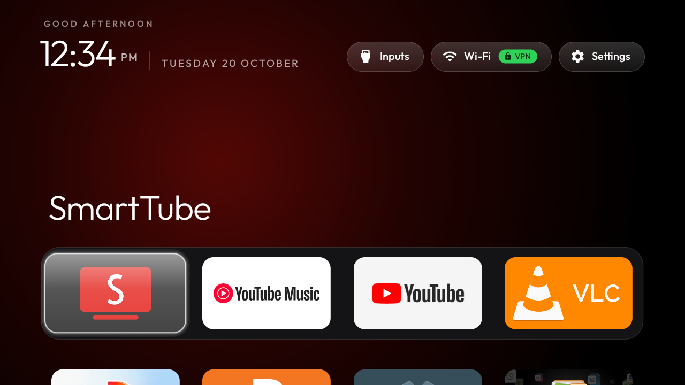
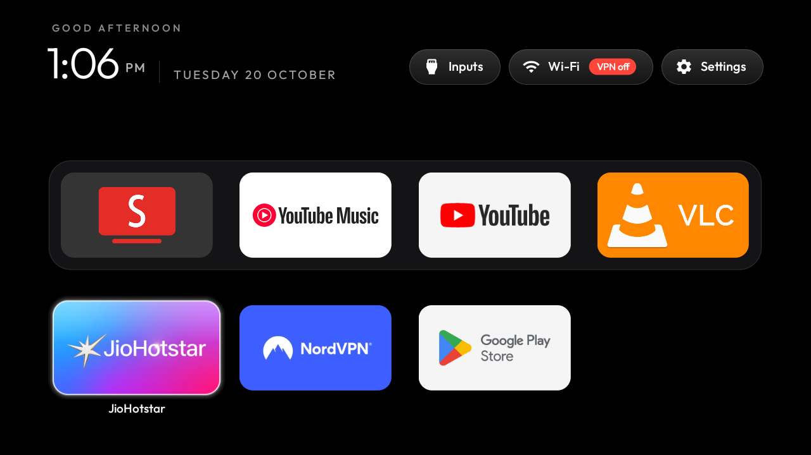
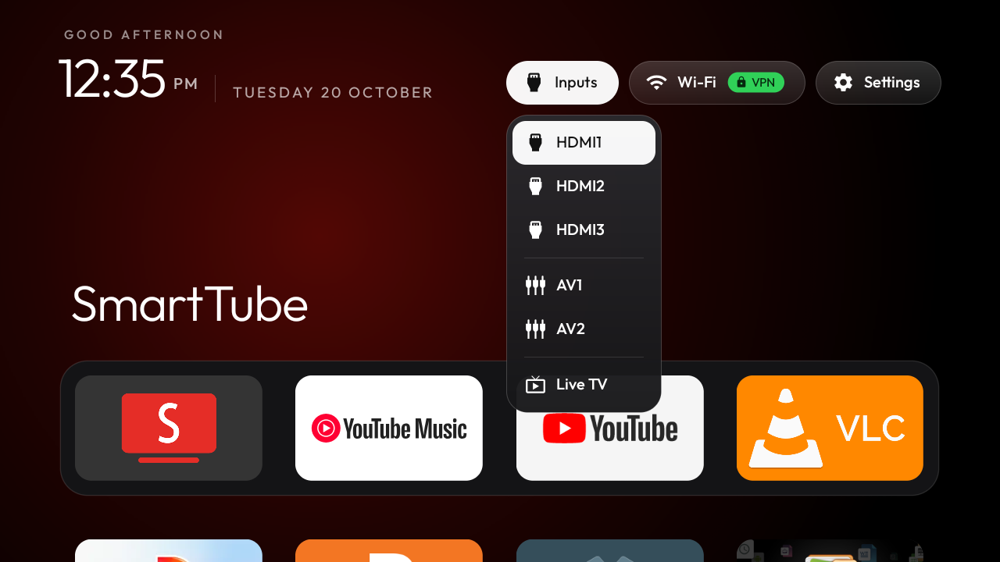
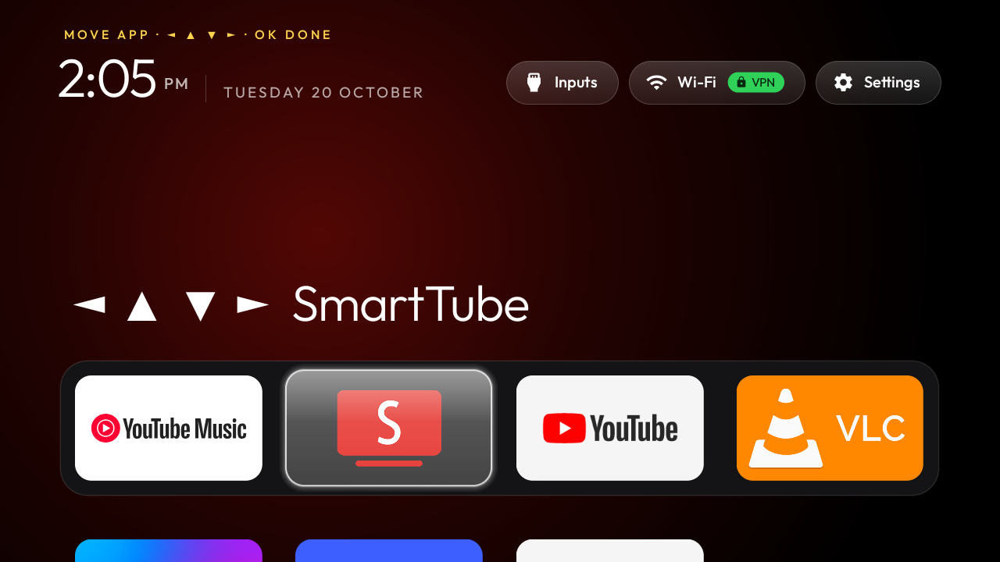
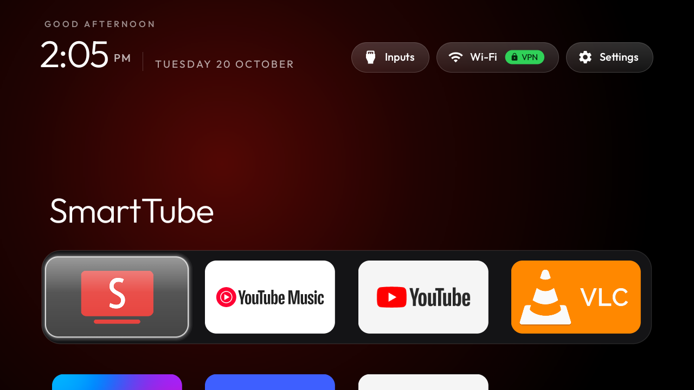
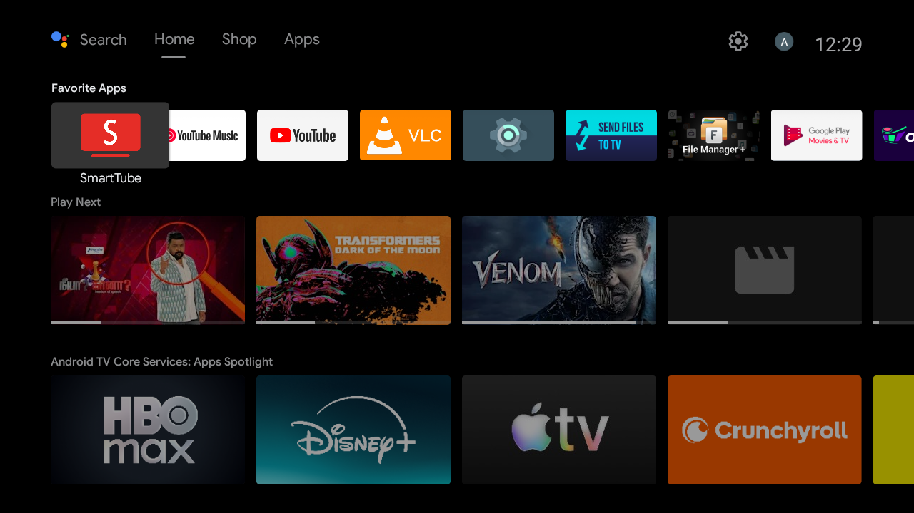

# SPPL `PATH_7XPRO` (`LEDTV32HD`) — Full Backup Snapshot, Benchmarks & Restore Guide

This directory contains the complete initial device snapshot, before-and-after verification screenshots, and standalone restore script for the **SPPL `PATH_7XPRO`** (`LEDTV32HD`, Android TV 9, Amlogic `AMLT950X`, 1 GB RAM).

For the full engineering breakdown, see [`examples/sppl-path-7xpro/README.md`](../examples/sppl-path-7xpro/README.md).

---

## 1. Before vs. After Proof Gallery

### Stock Android TV Home (Before) vs. Custom Apple TV-Style Dock (After)
| Before (`com.google.android.tvlauncher`) | After (`com.gathin.tvhome`) |
|---|---|
|  |  |

### Single-Screen App Grid & Hardware Inputs Menu
| Single-Screen App Grid (Only 7 Apps Total) | Hardware Inputs (`HDMI 1–3`, `AV 1–2`, `Live TV`) |
|---|---|
|  |  |

### 4-Way App Reordering (`Hold OK` → `◀ ▲ ▼ ▶` → `Press OK`)
| Move Mode Active (`MOVE APP · ◀ ▲ ▼ ▶ · OK DONE`) | Move Mode Completed & Saved |
|---|---|
|  |  |

### Debloat Batch Verification Screenshots
| Batch 1 | Batch 2 | Batch 3 |
|---|---|---|
|  |  |  |

---

## 2. Measured Performance & Storage Improvements

| Metric | Before | After | Delta |
|---|---|---|---|
| **Available RAM (of `1,014 MB`)** | `279 MB` (`MemFree: 36 MB`) | **`563 MB`** (`MemFree: 311 MB`) | **+284 MB RAM freed (`2.02×` available RAM)** |
| **Free Storage (`/data` of `4.2 GB`)** | `516 MB` free (`89%` used) | **`2.2 GB` free (`47%` used)** | **+1.7 GB freed (`4.3×` more free space)** |
| **Disabled System Bloat** | `0` disabled | **`42` packages disabled** | Stripped `/data` updates & caches |
| **Uninstalled Redundant Apps** | `14` third-party apps | **`11` apps removed** | Only 7 apps remain + `458 MB` APKs deleted |
| **SmartTube (`org.smarttube.stable`)** | `v32.10` (`universal`) | **`v32.56 Stable` (`armeabi-v7a`)** | Latest native 32-bit ARM build |
| **ART Compilation (`dex2oat`)** | JIT / partial profile | **`-m speed` (100% AOT)** | Native machine code for all kept apps |

---

## 3. Contents of This Backup Snapshot

| File | Description |
|---|---|
| [`restore-all.ps1`](restore-all.ps1) | One-click PowerShell script to re-enable all originally enabled packages and restore the stock launcher |
| [`packages-all.txt`](packages-all.txt) | Full list of all 102 originally installed packages |
| [`packages-enabled.txt`](packages-enabled.txt) | All 101 packages enabled prior to debloating |
| [`packages-disabled.txt`](packages-disabled.txt) | Packages disabled prior to debloating (`com.amazon.amazonvideo.livingroom`) |
| [`packages-system.txt`](packages-system.txt) | All 88 system packages on `/system` and `/vendor` |
| [`packages-thirdparty.txt`](packages-thirdparty.txt) | All 14 originally installed third-party packages on `/data/app` |
| [`packages-paths.txt`](packages-paths.txt) | APK installation paths for every package |
| [`getprop.txt`](getprop.txt) | Full `getprop` hardware and firmware properties dump (serial/MAC redacted) |
| [`settings-global.txt`](settings-global.txt) | Initial `settings list global` dump |
| [`settings-secure.txt`](settings-secure.txt) | Initial `settings list secure` dump (`android_id`/BT MAC redacted) |
| [`settings-system.txt`](settings-system.txt) | Initial `settings list system` dump |

---

## 4. How to Restore or Customize

### Restore Everything to Stock
```powershell
# Option A: Using CleanYourTV's recovery record
powershell -ExecutionPolicy Bypass -File tools\restore.ps1 -TvHost 192.168.29.239 examples\sppl-path-7xpro\debloat.txt

# Option B: Standalone full restore from this backup folder
powershell -ExecutionPolicy Bypass -File backup-path-7xpro\restore-all.ps1 -TvHost 192.168.29.239
```

### Move Apps on the TV Remote
1. **Hold `OK`** (or press **`Menu`**) on any app tile on the Home screen to enter **Move Mode** (`MOVE APP · ◀ ▲ ▼ ▶ · OK DONE`).
2. Press **Left / Right / Up / Down** on the D-pad to move the app anywhere across the Dock and Grid.
3. Press **`OK`** or **`Back`** to lock in your layout.

### Re-Enable or Disable Individual Packages
```powershell
$env:TV_HOST = "192.168.29.239"
.\tools\venv\Scripts\python.exe -I .\tools\tv.py "pm enable --user 0 <package.name>"
.\tools\venv\Scripts\python.exe -I .\tools\tv.py "pm disable-user --user 0 <package.name>"
```
